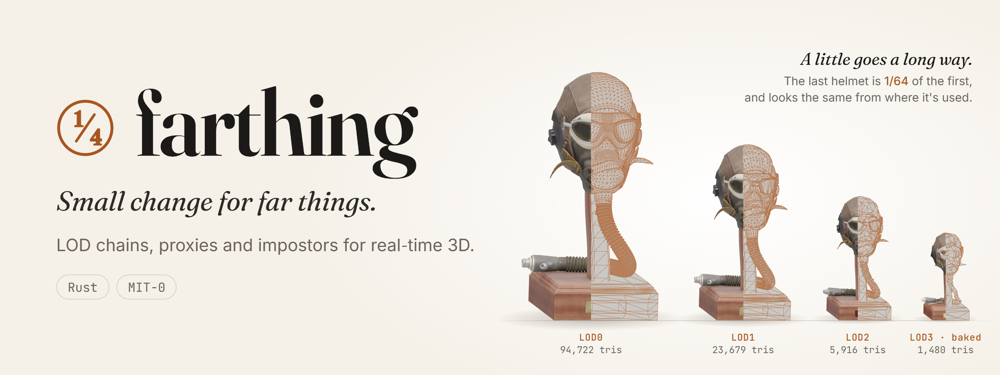
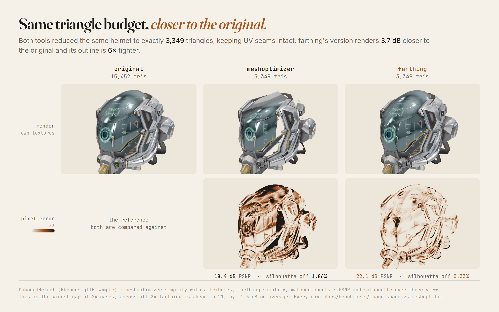
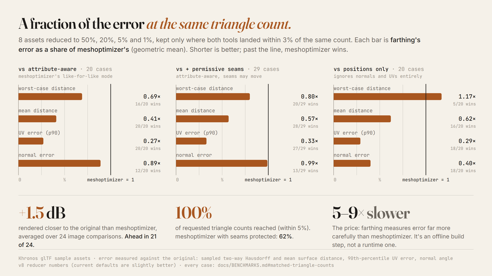
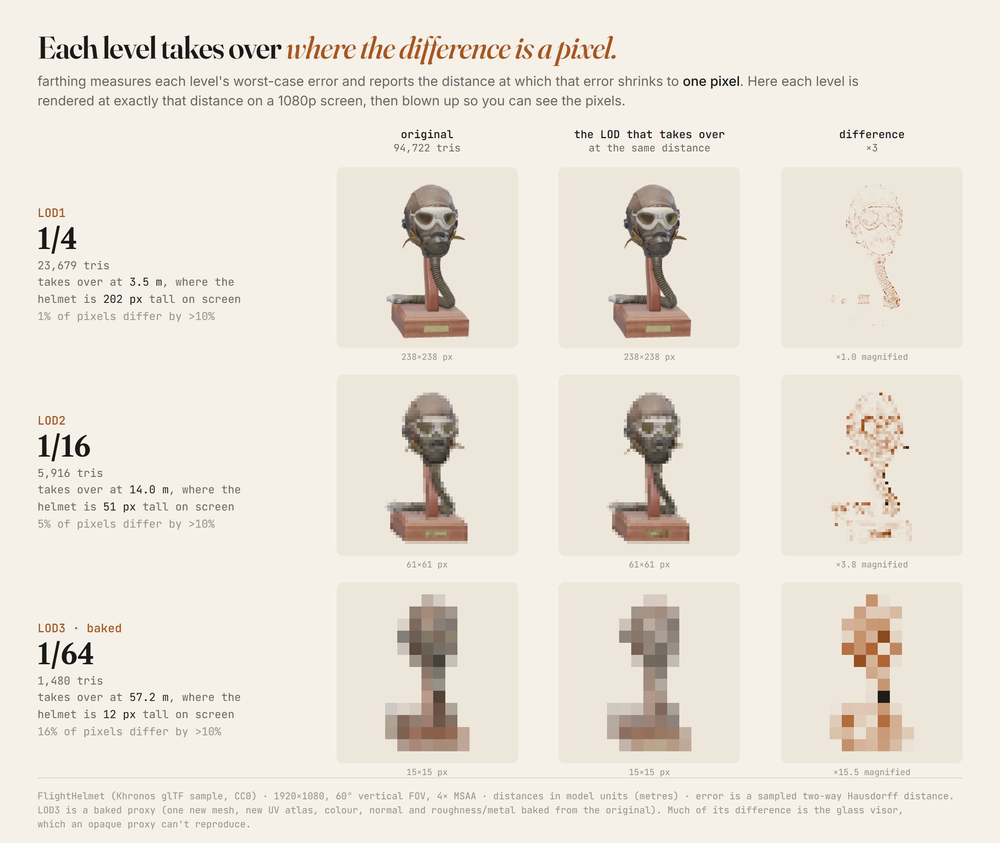
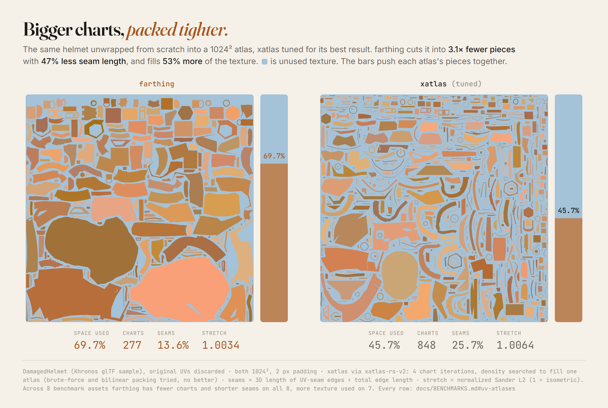
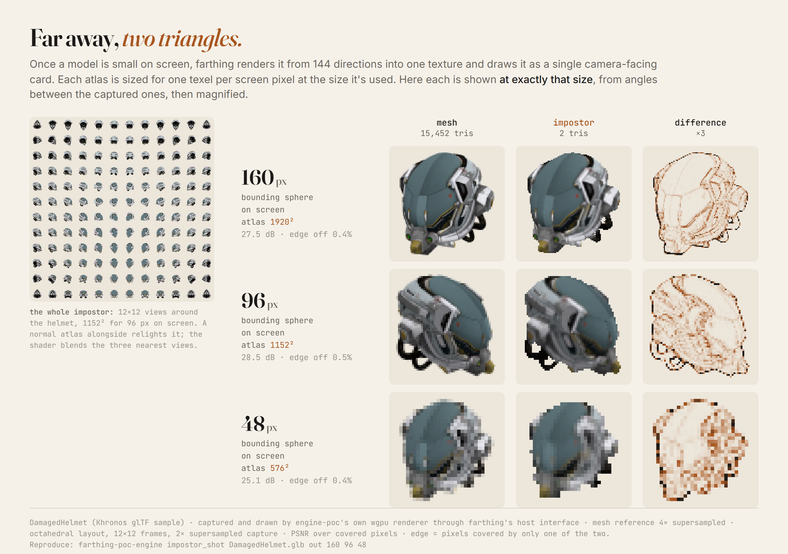

<picture>
  <source media="(prefers-color-scheme: dark)" srcset="docs/images/hero-dark.png">
  
</picture>

[](https://github.com/Azazel-Labs/farthing/actions/workflows/ci.yml)
[](https://crates.io/crates/farthing)
[](https://docs.rs/farthing)
[](https://www.rust-lang.org)
[](LICENSE-MIT0)
[](https://azazel-labs.github.io/farthing/)

**farthing makes far things small.** It builds the LODs, proxies and impostors that stand in
for what's in the distance, and it keeps them looking like the original from where they're
seen. A farthing was the smallest coin. *A little goes a long way.*

It's a pure-Rust, engine-agnostic asset optimizer. It has no `unsafe` code, gives the same
output on any machine and any thread count, and is MIT-0 licensed. Use it as a library, a CLI
or a build step.

## Closer to the original at the same triangle count

<picture>
  <source media="(prefers-color-scheme: dark)" srcset="docs/images/h2h-dark.png">
  
</picture>

farthing's reducer protects what you actually see: silhouettes, UV seams, shading normals and
texture layout. This is the widest gap of the 24 image comparisons. Across all 24, farthing is
ahead in 21, by +1.5 dB on average
([every case](docs/benchmarks/image-space-vs-meshopt.txt)).

<picture>
  <source media="(prefers-color-scheme: dark)" srcset="docs/images/bench-dark.png">
  
</picture>

Measured over 8 assets at 50%, 20%, 5% and 1% of their triangles. The price is speed:
farthing is 5–9× slower than meshoptimizer because it measures error much more carefully.
That's meant for a build step, not for every frame. A fast mode gets within 2× of
meshoptimizer's speed and still has lower distance and UV error (normals are slightly worse). Methodology and per-asset tables are in
[docs/BENCHMARKS.md](docs/BENCHMARKS.md#triangle-reduction).

## Every level comes with the distance to use it

<picture>
  <source media="(prefers-color-scheme: dark)" srcset="docs/images/switch-dark.png">
  
</picture>

farthing measures each level's worst-case deviation from the original and turns it into a
switch distance: the point where that error is one pixel on a 1080p screen. You don't have to
tune distances by eye. The farthest level here is a baked proxy, one new mesh with a new UV
atlas and colour, normal and roughness/metal textures baked from the original. Most of its
difference is the glass visor, which an opaque proxy can't reproduce.

## UV atlases with fewer seams and less wasted texture

<picture>
  <source media="(prefers-color-scheme: dark)" srcset="docs/images/atlas-dark.png">
  
</picture>

Far levels need a fresh UV atlas to bake into. Against xatlas at its best settings, with
both packed into the same 1024² atlas, farthing makes fewer charts with shorter seams on
all 8 benchmark assets and uses more of the texture on 7 (67% on average, against 59%).
Stretch is a near tie: farthing is lower on 5 assets, and every result is within 1% of
isometric ([data](docs/BENCHMARKS.md#uv-atlases)). The packer is available on its own as
[`snugly`](https://crates.io/crates/snugly).

## Impostors for the far distance

<picture>
  <source media="(prefers-color-scheme: dark)" srcset="docs/images/impostor-dark.png">
  
</picture>

Past a hundred pixels or so, a whole model becomes one card. farthing plans the views, your
engine renders them with its real materials, and farthing assembles a relightable atlas sized
for one texel per screen pixel. It ships with a reference shader that blends between views
and marches depth for parallax.

## What's in the box

| | What it does | How |
|---|---|---|
| **Reduction** | LODs by ratio, triangle count, error bound or screen size, with a switch distance for each level | Attribute-aware quadric edge collapse (UVs, colours, normals, skin weights, morph targets), silhouette-weighted, with batched parallel rounds. UV seams are permissive or strict. Whole parts are removed when they stop being visible. Symmetry is detected and preserved. Includes a fast mode |
| **Quad reduction** | Lowers quad meshes and keeps them all quads | Removes edge rings, ranked by quadric error, in linear time |
| **Proxies** | Rebuilds a messy kitbash or scene as one closed, manifold mesh | Voxelization with sub-voxel signed boundaries, leak-aware gap sealing, surface nets, then reduction |
| **UV atlases** | Fresh atlases for proxies and far LODs | LSCM + ARAP charts with exact overlap tests, split and merge under stretch limits, packed by `snugly` |
| **Baking** | Moves colour, normal, roughness/metal and any custom channel onto the new mesh | farthing finds where each texel comes from on the source surface, and your engine shades it. Supersampled, dilated, MikkTSpace normals. Has a two-phase API for async GPUs |
| **Aggregation** | Merges many objects into one draw call | Material classes, island repacking by texel density, texel copy |
| **Impostors** | Cards for the far distance | Octahedral, hemi-octahedral, flipbook or single view, with an optional second depth layer, billboard clouds and progressive surfel clouds. Reference WGSL included |
| **Visibility & occluders** | Removes what can't be seen and builds occlusion geometry | Camera-sampled ID renders (alpha-aware through your engine), plus conservative self-tuning occluder meshes and boxes |
| **Bones** | Fewer joints and influences for far LODs | Leaf-first removal by skinned error, influence limiting |
| **I/O** | glTF/GLB (skins, morphs, embedded textures) and OBJ | Optional `io` feature |

**farthing never decides what anything looks like.** It handles geometry, UVs,
correspondence and packing. Anything that needs real materials goes through a small
`RenderHost` trait that your engine implements. That covers baking, impostor captures and
alpha-aware visibility. So world-space, procedural and engine-specific materials all bake
correctly. [`engine-poc/`](engine-poc/) is a minimal wgpu engine that proves the boundary
with procedural materials farthing never sees.

## Try it

**In the browser.** [Open the live demo](https://azazel-labs.github.io/farthing/) (source in
[`demo-web/`](demo-web/)). It runs the whole pipeline in WebAssembly. Drop a
glTF, watch the LOD chain build and bake, and fly out to see the levels switch. Nothing is
uploaded.

**From the command line.** Grab a prebuilt binary from
[Releases](https://github.com/Azazel-Labs/farthing/releases), or build it:

```sh
cargo install farthing-cli

farthing lods model.glb -o lods/ --levels 4 --far-from 3   # LOD chain, far levels baked
farthing reduce model.glb -o lod.glb --ratio 0.25           # one level
farthing reduce model.glb -o lod.glb --ratio 0.25 --strict-seams --symmetry
farthing remesh scene.glb -o proxy.glb --resolution 128 --triangles 3000
farthing uv far.glb -o far_uv.glb
farthing occluder scene.glb -o occ.glb --triangles 300 --boxes 8
farthing bones character.glb -o char_lod.glb --ratio 0.5 --influences 2
farthing quad-reduce character.obj -o character_lod.obj --ratio 0.25
```

**As a library:**

```toml
[dependencies]
farthing = "0.15"                                            # with glTF/OBJ I/O
# farthing = { version = "0.15", default-features = false }  # geometry only
```

| Integration level | How | Use when |
|---|---|---|
| Geometry only | Call `simplify`, `remesh`, `occluder`, `parameterize` and others on `Mesh`/`Scene` values | Offline tools and build steps with no material needs |
| `RenderHost` | Implement the five-method trait (example: [`engine-poc/src/engine.rs`](engine-poc/src/engine.rs)) | Baking, impostors and visibility with your engine's real materials |
| Two-phase bake | `prepare_bake` → shade the samples on your GPU, any thread, any timing → `finish_bake` | Engines that render asynchronously or batch GPU work |
| Files + CLI | glTF/OBJ in, glTF/OBJ and JSON reports out | Asset pipelines, CI, non-Rust tooling |

## Using the library

farthing is a set of functions over two data types. Each function takes plain data, returns
plain data and keeps no global state, so you can call them in any order, from any thread. This
section goes through them in roughly the order an asset pipeline uses them. Every snippet runs
inside a function that returns `farthing::Result<()>`.

### Meshes and scenes

A `Mesh` is an indexed triangle list. Its vertices are *wedges*: one vertex per unique set of
attributes, so a UV seam is two vertices at the same position. GPUs use the same layout, so
you can build a mesh straight from your vertex buffers:

```rust
use farthing::Mesh;

let mut mesh = Mesh::new(positions, indices);       // Vec<Vec3>, Vec<u32>
mesh.normals = Some(normals);                       // all optional: normals, tangents,
mesh.uvs = vec![uv0];                               // any number of UV sets, colours,
mesh.material_ids = vec![0; mesh.triangle_count()]; // skin weights, morph targets
mesh.validate()?;
```

A `Scene` holds meshes, instances with world transforms, skeletons and material *slots*. A
slot is just a name and an id. farthing never knows what a material looks like. The `io`
feature reads and writes glTF, GLB and OBJ:

```rust
let scene = farthing::io::load("model.glb")?;                   // .glb, .gltf or .obj
let (scene, materials) = farthing::io::load_gltf("model.glb")?; // plus the decoded glTF materials
let (scene, materials) = farthing::io::load_gltf_with(&bytes, |uri| files.get(uri).cloned())?; // no file system
let scene = farthing::Scene::from_mesh(mesh);                   // one mesh at the origin
```

### Reduction

`simplify` reduces one mesh. The result includes the largest deviation it introduced, in
world units:

```rust
use farthing::reduce::{simplify, SimplifyOptions};

let r = simplify(&mesh, &SimplifyOptions::ratio(0.25))?;
println!("{} triangles, error {}", r.mesh.triangle_count(), r.error);
```

There are three ways to set a target: a share of the triangles (`target_ratio`), a count
(`target_triangles`) or an error bound (`max_error`). With more than one target, `stop` decides
whether reduction ends at the first one met (`StopWhen::Any`) or the last (`StopWhen::All`).
For an object that is never larger than a known size on screen, convert pixels to an error
bound:

```rust
use farthing::reduce::{screen_size_to_max_error, SimplifyOptions};

// 300 px across on screen, allowed to be off by half a pixel.
let max_error = screen_size_to_max_error(mesh.bounds().diagonal(), 300.0, 0.5);
let opts = SimplifyOptions { max_error: Some(max_error), ..Default::default() };
```

The defaults are what scored best in the benchmarks. These are the options you're most
likely to change:

```rust
use farthing::reduce::{Quality, SeamMode, SimplifyOptions, Symmetry};

let opts = SimplifyOptions {
    target_ratio: Some(0.1),
    seams: SeamMode::Strict,   // UV islands keep their exact outlines (may stop short of the target)
    symmetry: Symmetry::Auto,  // find a mirror plane and keep both halves identical
    lock_border: true,         // open edges stay put, so tiles and modular pieces still line up
    error_normalization: 1.0,  // classic QEM: protects small features, costs overall fidelity
    quality: Quality::Fast,    // several times faster; skips symmetry and part removal
    ..Default::default()
};
```

A few more options:

- `vertex_importance` scales the cost of collapsing each vertex.
- `locked_vertices` pins vertices in place.
- `transparent_materials` lists glass and visors, so parts behind them still count as visible.

The result also maps vertices both ways:

- `vertex_remap` gives, for each input vertex, the output vertex it collapsed into. Use it to
  geomorph between levels.
- `source_vertex` gives, for each output vertex, the input vertex it copies. Use it to carry
  your own vertex data across.

`simplify_scene` reduces every mesh of a scene in parallel.

### LOD chains and switch distances

`lod_chain` reduces each level from the one before and adds up the errors, so every level
reports how far it is from the original:

```rust
use farthing::reduce::{lod_chain, SimplifyOptions};

let levels = lod_chain(&mesh, &[0.25, 0.0625, 0.015625], &SimplifyOptions::default())?;
let (screen_height, fov_y) = (1080.0, 60f32.to_radians());
for (i, level) in levels.iter().enumerate() {
    // The distance at which this level's error covers one pixel: switch to it from there out.
    let switch = level.error * screen_height / (2.0 * (fov_y / 2.0).tan());
    println!("LOD{i}: {} triangles, from {switch:.1} m", level.triangles);
}
```

Errors are in the mesh's own units. For an instance drawn at a scale, multiply by the scale.

### New UVs for far levels

Far away, an original's UV layout wastes texture: every material keeps its own islands, and
the seams between them keep the reducer from simplifying further. Drop the attributes, reduce
the bare geometry, and give it one fresh atlas:

```rust
use farthing::reduce::{repair, simplify, SimplifyOptions};
use farthing::uv::{parameterize, ParamOptions};

let (flat, _) = scene.flatten();               // every instance in world space
let mut far = repair::geometry_only(&flat);    // positions only: no seams to hold it back
far.material_ids.iter_mut().for_each(|m| *m = 0);
let opts = SimplifyOptions { target_triangles: Some(500), ..Default::default() };
let mut far = simplify(&far, &opts)?.mesh;
far.compute_normals(60.0);                     // hard edges above 60°

let uv = parameterize(&far, &ParamOptions { atlas_size: 512, padding: 2, ..Default::default() })?;
println!("{} charts, {:.0}% of the atlas used", uv.charts, uv.utilization * 100.0);
```

`parameterize` returns the mesh split along chart boundaries, with the new UVs in set 0. Every
chart gets the same texel density. Set `texels_per_unit` to choose that density yourself.
`ParamOptions::planar()` is a faster unwrap for boxy shapes.

### Baking through your engine

The new mesh needs textures made from the original's materials. farthing works out where each
texel comes from on the source surface, and your engine decides what that point looks like,
through the `RenderHost` trait:

```rust
use farthing::glam::Vec4;
use farthing::host::*;
use farthing::image::Image;
use farthing::MaterialId;

struct MyEngine { /* your materials */ }

impl RenderHost for MyEngine {
    fn material_info(&self, _material: MaterialId) -> MaterialInfo {
        MaterialInfo::default() // opaque, one-sided
    }
    fn bake_surface(&mut self, req: &SurfaceBakeRequest) -> farthing::Result<ChannelImages> {
        // One optional sample per texel: the source surface's world position, normal,
        // tangent, both UV sets and vertex colour at that texel, and its material.
        let mut color = Image::new(req.width, req.height, Vec4::ZERO);
        for (i, s) in req.samples.iter().enumerate() {
            if let Some(s) = s {
                color.pixels[i] = self.shade(s.material, s.uv[0], s.position);
            }
        }
        let mut out = ChannelImages::new();
        let image = ChannelImage { image: color, encoding: ChannelEncoding::Color };
        out.insert(channels::BASE_COLOR.into(), image);
        Ok(out)
    }
    fn render_views(&mut self, _req: &ViewRenderRequest) -> farthing::Result<Vec<ViewImages>> {
        todo!("only impostors need this")
    }
    fn create_material(&mut self, _desc: &BakedMaterialDesc) -> farthing::Result<MaterialId> {
        todo!("only needed when you ask farthing to make the material")
    }
}
```

Your engine shades points instead of handing over textures. That's why world-space,
triplanar and procedural materials bake correctly. `GeometryOnlyHost` is a host with no
materials. It is enough for reduction, proxies, occluders, bones and visibility. With a host
in hand, bake:

```rust
use farthing::bake::{bake_with_host, compute_tangents, BakeOptions};
use farthing::glam::Mat4;
use farthing::host::channels;

let mut far = uv.mesh;
compute_tangents(&mut far, 0)?;                // MikkTSpace, for the baked normal map
let opts = BakeOptions {
    width: 512,
    height: 512,
    channels: vec![channels::BASE_COLOR.into(), channels::NORMAL.into(), channels::ORM.into()],
    ..Default::default()
};
let baked = bake_with_host(&mut engine, &far, Mat4::IDENTITY, &scene, &opts)?;
let color = &baked.textures[channels::BASE_COLOR].image;
```

A few things the bake handles for you:

- **Normals.** Return them as `ChannelEncoding::NormalWorld` and farthing converts them to
  the new mesh's tangent space.
- **Quality.** Each texel is supersampled (2×2 by default), and the edges are dilated into
  the gutters.
- **Re-baking.** `baked.correspondence` keeps the traced map from texels to the source
  surface, so you can bake more channels later without tracing again.
- **Textures you already have.** If your materials are already flat images in the source
  UVs, `bake_flattened` copies texels and needs no host at all.

If your engine shades on a GPU queue, on another thread or across an FFI boundary, split the
bake in two:

```rust
use farthing::bake::{finish_bake, prepare_bake};

let prepared = prepare_bake(&far, Mat4::IDENTITY, &scene, &opts)?;
let shaded = gpu.shade(&prepared.request).await; // ChannelImages; any time, any thread
let baked = finish_bake(prepared, shaded)?;
```

### Proxies and occluders

`remesh` turns a whole scene into one closed, manifold mesh. It works on kitbashes, piles of
intersecting parts and buildings with interiors you'll never see, and gives a clean stand-in
for the far distance. Unwrap and bake it as above.

```rust
use farthing::voxel::{remesh, RemeshOptions};

let proxy = remesh(&scene, &RemeshOptions {
    resolution: 128,              // voxels along the longest side
    close_gaps: 2,                // seal leaks up to two voxels wide
    target_triangles: Some(3000),
    ..Default::default()
})?;
```

`occluder` builds a low-poly mesh that stays inside the original, for occlusion culling.
`box_occluders` returns a few boxes instead:

```rust
use farthing::voxel::{box_occluders, occluder, OccluderOptions};

let occ = occluder(&scene, &OccluderOptions { target_triangles: 300, ..Default::default() })?;
let boxes = box_occluders(&scene, 64, 8)?;    // up to 8 boxes from a 64-voxel grid
```

### Impostors

Once a model is a few dozen pixels on screen, a camera-facing card showing a picture of it
costs less than any mesh. Give farthing the size on screen where the impostor takes over. It
plans the cameras, has your engine render them, and packs the atlas:

```rust
use farthing::impostor::{build_impostor, frame_size_for_screen, ImpostorKind};

let frame = frame_size_for_screen(96.0);       // 96 px across when the impostor takes over
let kind = ImpostorKind::Octahedral { frames_per_side: 12, hemisphere: false };
let imp = build_impostor(&mut engine, &scene, &kind, frame, false)?;
// imp.atlas: colour, normal and height atlases. imp.quad: the card.
// imp.params: serialize it next to the atlas for the shader.
```

Other kinds of impostor:

- `hemisphere: true`, for objects never seen from below.
- `ImpostorKind::Flipbook`, a ring of views around the object.
- `ImpostorKind::SingleView`, one view from a fixed direction.
- `build_layered_impostor`, which captures a second depth layer for concave props.
- `billboard_cloud` and `progressive_surfel_cloud`, for shapes one card can't hold.

The reference shader is
[`shaders/octahedral_impostor.wgsl`](crates/farthing/shaders/octahedral_impostor.wgsl).

### Merging objects

`aggregate` merges a scene into one mesh with one atlas per material class, so a room full
of props becomes one draw call. Then copy each texture into the atlas:

```rust
use farthing::aggregate::{aggregate, copy_texels, AggregateOptions};

let infos: Vec<_> = scene.materials.iter().map(|m| engine.material_info(m.id)).collect();
let merged = aggregate(&scene, &infos, &AggregateOptions { atlas_size: 2048, ..Default::default() })?;
let color = copy_texels(&merged, &flattened, channels::BASE_COLOR)?; // flattened: FlattenedTextures
```

### Visibility

Remove what no camera can see, such as the underside of a building or the inside of a closed
box:

```rust
use farthing::visibility::{compute_visibility, cull_invisible, CameraSet, VisibilityOptions};

let vis = compute_visibility(&mut engine, &scene, &VisibilityOptions {
    cameras: CameraSet::Hemisphere { count: 64, distance_factor: 2.5 },
    resolution: 256,
})?;
let (culled, removed) = cull_invisible(&scene, &vis, 1); // keep one ring around what was seen
```

The default `render_ids` is a CPU ray caster that treats alpha-tested materials as opaque.
Override it in your host to let cutouts through. `CameraSet::Points` places cameras along a
play path instead.

### Skinned meshes

A character's far levels need fewer bones and fewer influences per vertex:

```rust
use farthing::bones::*;

let opts = BoneReductionOptions { ratio: Some(0.5), ..Default::default() };
let plan = plan_bone_reduction(&skeleton, &[&mesh], None, &opts)?;
apply_bone_reduction(&mut mesh, &plan);
let (skeleton, remap) = compact_skeleton(&skeleton, &plan);
remap_joint_indices(&mut mesh, &remap);
limit_influences(&mut mesh, 2);
```

Pass animation poses as the third argument and each bone's removal error is measured in
motion, not just from the bind pose.

### Writing results

```rust
use farthing::io::{save_glb, ExportTextures};
use farthing::reduce::optimize::optimize_mesh;

optimize_mesh(&mut far);                       // vertex cache and vertex fetch order
let out = farthing::Scene::from_mesh(far);
let mut tex = ExportTextures::default();
tex.base_color.insert(0, baked.textures[channels::BASE_COLOR].image.clone());
tex.normal.insert(0, baked.textures[channels::NORMAL].image.clone());
save_glb(&out, "far.glb", &tex)?;              // glb_bytes(&out, &tex) for memory
```

The option structs implement `serde`, so pipeline settings can live in your asset database.
Work runs on rayon's thread pool, and the output is the same on any thread count.

## Honest limits

- **Speed.** The default reducer is 5–9× slower than meshoptimizer on small assets and 2–3×
  on large ones. About 88% of the work runs in parallel. Fast mode closes most of the gap.
- **Worst-case distance against positions-only reducers.** Ranking by area-weighted error
  trades a little worst-case distance for much better mean, UV and normal fidelity. Set
  `error_normalization = 1.0` for classic QEM when only the outline matters.
- **Very aggressive targets** (1% and below). farthing leads on every quality average, but a
  few cases are still worse, such as a watch's strap lugs at 1%.
- **Proxies** can trail marching cubes on deep, narrow slots (the dragon: 1.39% vs 0.87% worst
  case, though marching cubes leaves 6% of it open). farthing's proxies are always closed and manifold.
- **Opaque proxies can't reproduce transmission or refraction**, as the visor above shows.

The details, and what was tried and reverted, are in [docs/BENCHMARKS.md](docs/BENCHMARKS.md).
Technique sources are in [PROVENANCE.md](PROVENANCE.md), and ideas borrowed from other sciences
are in [docs/research/](docs/research/README.md).

## Patent shame list

Patents on techniques in farthing's space that it deliberately stays clear of, with how it does
so. Status and dates are from Google Patents as of November 2026; Google itself labels status
an assumption, not a legal conclusion. This is a working list, not legal advice, and farthing has
not had a freedom-to-operate review. If you know of one that belongs here, open an issue.

**Active: designed around**

| Patent | Owner | What it claims, in short | Status | How farthing stays clear |
|---|---|---|---|---|
| [US 12,112,510 B2](https://patents.google.com/patent/US12112510B2/en), *Convolutional approach to fast and compact packing of 3D mesh into 2D maps* | Tencent America LLC | Placing each UV chart where a correlation between the atlas occupancy map and the chart's occupancy matrix shows no overlap | Active, granted 2024-10-08, est. expiry 2043-05-11 | The packer drops charts onto a per-column skyline outline; it never correlates masks against an occupancy map. FFT/correlation placement, proposed twice in the v8 research, is off the table. |
| [US 12,394,102 B2](https://patentsgazette.uspto.gov/week33/OG/html/1537-3/US12394102-20250819.html), *Mesh parameterization with temporally correlated UV atlases* | Tencent America LLC | Generating a frame's UV atlas by aligning its charts with reference charts from previous frames, via packing | Granted 2025-08-19 (filed 2023-03-16) | farthing parameterizes each mesh on its own; it has no per-frame atlases for animated sequences. Anything like that would need a different design. |
| [US 9,978,176 B2](https://patents.google.com/patent/US9978176B2/en), *Simplifying small mesh components with redundant backs* | Electronic Arts Inc. | Casting a ray along a surface's normal and removing that surface from a component when the ray hits other geometry within a threshold distance | Active, granted 2018-05-22, est. expiry 2036-03-31 | Part removal (v8) deletes whole connected parts or nothing, using closest-point distances. It casts no normal rays and never strips individual surfaces from a part. |

**Expired: free for everyone** (listed for credit, and so nobody avoids them by mistake)

| Patent | Owner | What it covered | Status |
|---|---|---|---|
| [US 6,362,820 B1](https://patents.google.com/patent/US6362820B1/en), *Quadric metric for simplifying meshes with appearance attributes* (Hoppe) | Microsoft | The attribute quadric with wedges that farthing's reducer builds on | Expired (lifetime) |
| [US 8,860,723 B2](https://patents.google.com/patent/US8860723B2/en), *Bounded simplification of geometrical computer data* | Donya Labs AB (Simplygon), now Microsoft | Collapse-based reduction that projects removed geometry onto the reduced mesh and stops at an error bound | Lapsed 2022-11-21 for unpaid fees |
| [US 8,698,809 B2](https://patents.google.com/patent/US8698809B2/en), *Creation and rendering of hierarchical digital multimedia data* | Donya Labs AB, now Microsoft | Repeatedly combining objects and simplifying each combination into a stand-in (hierarchical LOD) | Expired (fees) |

## Layout

```
crates/farthing/       the library: data model at the root, then io/ reduce/ uv/ bake/
                       aggregate/ voxel/ visibility/ impostor/ bones/, reference WGSL in shaders/
crates/farthing-cli/   the `farthing` binary
demo-web/              WebAssembly browser demo (separate workspace)
engine-poc/            wgpu engine implementing RenderHost (separate workspace)
bench-compare/         head-to-head vs meshoptimizer, xatlas, baby_shark (separate workspace)
docs/                  BENCHMARKS.md, raw benchmark data, figures
```

License: [MIT-0](LICENSE-MIT0) (MIT No Attribution).
