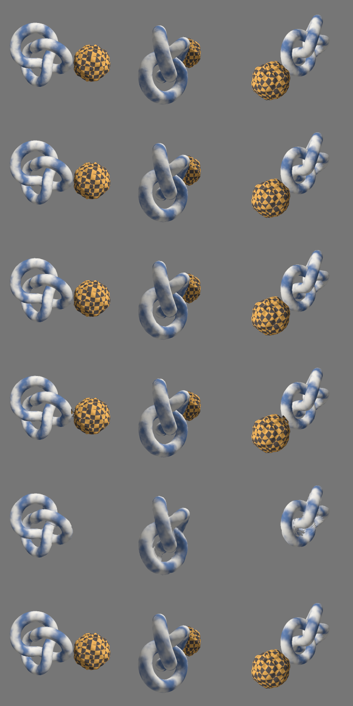
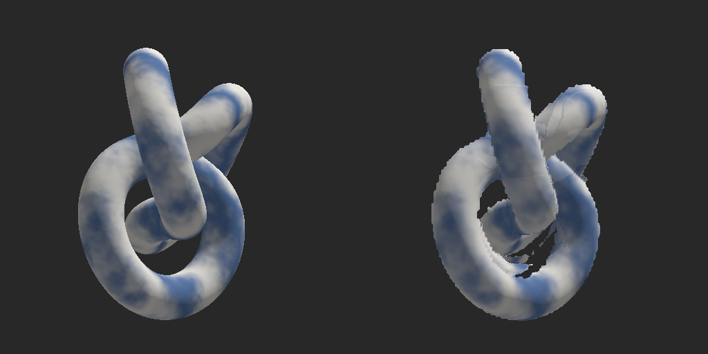

<picture>
  <source media="(prefers-color-scheme: dark)" srcset="docs/images/hero-dark.png">
  
</picture>

*Small change for far things.* A farthing was the smallest coin; the toolkit makes far things
small: LODs, proxies and impostors for what's in the distance. (Formerly lodforge.)

A clean-room, pure-Rust asset optimization toolkit: LOD chains, quad-preserving and
symmetry-aware reduction, remeshed proxies, material baking, aggregation, impostors,
visibility culling, occluders and bone reduction. It is engine-agnostic middleware, built from
published techniques (see [PROVENANCE.md](PROVENANCE.md)).

**v15 (0.15.0).** The UV atlas now beats xatlas on utilization on all eight test assets (Fox 0.634 vs 0.547), by splitting sprawling charts and also packing chart bounding boxes with MaxRects. `snugly` 0.1.0 is ready to release as its own crate: error types, an optional `parallel` feature (WASM builds), a verified MSRV, CI and an export script. Aggressive targets: junction branch points collapse, and fast mode shares the default's part and junction handling. Impostors get a half-resolution second layer and automatic layer choice; surfels get a reference splat shader and optional per-surfel radii. Everything is MIT-0. The toolkit is renamed **Farthing** (one library crate `farthing`, CLI `farthing`) and the packer **snugly**.
**v14 (0.14.0):** A fast reducer mode (4–5× faster than the default, still ahead of
meshoptimizer on worst-case and mean error). `snugly` is product-ready: it now has the
highest rectangle-packing density of the Rust packers tested, and shapes can nest inside each
other's holes. Aggressive targets are fixed: part removal respects the target and what can be
seen, junctions slide, duplicated double-sided faces reduce, and visible parts are protected.
Also two-layer impostors for concave props, and progressive surfels with a streaming format.
**v13 (0.13.0):** No `unsafe` code in any farthing crate (enforced with `forbid(unsafe_code)`), the atlas packer is now its own crate (`snugly`), the hole-filling packer is 25% faster on few-chart atlases, and `scripts/scaling.sh` measures thread scaling on your machines. **v12 (0.12.0):** Voxel proxies now sit on the source surface instead of up to a cell outside it: boundary cells take the sign of a robust signed distance, guarded so thin sheets survive. Worst-case distance drops on all seven test assets, by up to 53%, and farthing now beats baby_shark on the Duck and the Fox on both metrics. The reducer's commit loop runs in parallel on 8+ threads with no `unsafe`, bit-identical to the serial loop. **v11 (0.11.0):** Scales with cores, with output that stays bit-identical at any thread count (now tested for the reducer, quad reduction, UVs and the BVH). Quad reduction is linear-time: 240k quads in 2.4 s on one thread (v10: 8.8 s). A hole-filling packer for atlases with few large charts ties xatlas on the water bottle. **v10 (0.10.0):** Octahedral impostors relit and fixed (+3.5 dB close up), quad reduction 5–20× faster at scale. **v9 (0.9.0):** Surfel proxies for relightable distant foliage, per-pocket gap sealing for voxel proxies, a silhouette-aware reduction cost, and a [patent shame list](#patent-shame-list). Earlier, **v8 (0.8.0):** The reducer now reaches 100% of triangle targets. Edge collapses cannot remove
a part, so multi-part assets used to stall at aggressive targets, and their budget went to small
parts that could not shrink. farthing now deletes whole parts whose removal moves the surface
least. Over 8 assets × 4 ratios that cut mean error 14% and Hausdorff 9% (v9's silhouette weight
adds a little more). At 1% the Lantern went from 76.8% to 9.6% Hausdorff. Against
meshoptimizer's attribute-aware mode at matched triangle counts (v9): 0.69× Hausdorff, 0.41× mean,
0.27× UV and 0.89× normal error. LOD images beat meshoptimizer in 21 of 24 cases (+1.51 dB). The UV atlas beats xatlas on 22 of 24 quality
comparisons (v11 gave back its small speed lead for tighter packing of few-chart atlases). Voxel proxies are closed on every test asset (v7).
Output is deterministic across thread counts and CPUs. Full data:
[docs/BENCHMARKS.md](docs/BENCHMARKS.md). Ideas from other sciences:
[docs/research/](docs/research/README.md). Pure Rust, no `unsafe`, 122 tests.

The one design rule: **farthing never decides what anything looks like.** It does geometry,
UVs, correspondence and packing. Anything that needs real materials goes through a small
`RenderHost` trait, or the two-phase bake API, that the host implements. Baking,
impostor captures, alpha-aware visibility and image checks all fall in that category.
`engine-poc/` is a minimal wgpu engine that proves the boundary, with procedural materials
farthing never sees.



*Rows, top to bottom: original (46.9k tris) · near LOD 25% · far LOD 5% re-baked · remeshed
proxy 3k tris · per-object octahedral impostor (knot) · aggregated into one draw call. All
rendered by the PoC engine. The marble and checker are procedural world-space materials.*

## What's new in v15

| Area | v14 | v15 |
|---|---|---|
| UV utilization vs xatlas | Ahead on 6 of 8 (Fox 0.526 vs 0.547, water bottle 0.639 vs 0.640) | **Ahead on 8 of 8**: Fox **0.634**, water bottle **0.659**, BoomBox 0.671, DamagedHelmet 0.610, Lantern 0.744 (xatlas 0.547 / 0.640 / 0.168 / 0.470 / 0.626). Charts filling under 45% of their rectangle are split where the pieces' rectangles shrink ≥ 15% (`split_sprawling`); `pack()` also tries the charts' bounding rectangles with MaxRects. Stretch unchanged, seams still shorter than xatlas on 8/8. The UV stage is 25% slower than xatlas (was 8%) |
| `snugly` | A crate in the workspace | **Ready to release on its own (0.1.0)**: `PackError`, builder options, `#[non_exhaustive]` outputs, `pub use glam`, `parallel` (default) and `serde` features, no-rayon WASM build, golden-output test (identical with/without `parallel`, at 1 thread, on Rust 1.85 and stable), `missing_docs`, doctested README, CHANGELOG, versioning policy, CI workflow, `scripts/export-snugly.sh` (standalone repo + `cargo package`) |
| Aggressive targets | Junction ends and branch points locked | **They collapse onto a junction neighbour**: the watch at 1% reaches 1,175 tris (was 1,937). Geomean Hausdorff 12.85% (meshoptimizer 13.04%) |
| Fast mode | Locked junctions, deleted smallest parts by area | **Twins, junction sliding, visible-error part removal with floor and protection**: normal ratios 2.34% / 0.163% (v14 2.47% / 0.178%), aggressive 16.1% (17.2%) |
| Layered impostors | Full-resolution second layer, manual | **Half-resolution second layer** (vase: same +1.0 dB at 1.25× memory instead of 2×), **automatic choice** by `layer_benefit` (keeps it for the vase, drops it for the knot and bush), single-layer fallback for hosts that can't peel |
| Surfels | Disc meshes only, one radius | **Reference splat shader** (`SURFEL_SHADER`, dithered fade, G-buffer; validated with naga and matched to the disc meshes in the PoC), per-surfel radii in `lod()` and the stream, opt-in `adaptive_density` |
| MSRV | Declared 1.80 (wrong) | **Verified**: 1.88 for the workspace (`image`), 1.85 for `snugly` (`glam`) |
| License | MIT OR Apache-2.0 declared, MIT file only | **MIT-0** (`LICENSE-MIT0`) for every crate, the PoC and the harness |

## What was new in v14

| Area | v13 | v14 |
|---|---|---|
| Reducer speed | One quality level (about 7× slower than meshoptimizer on small assets) | **`Quality::Fast`** (`--fast`): f32 quadrics in the unit-diagonal frame, cost-sorted passes over every edge, link and flip checks, border sliding, part deletion on stall. 8 assets × 4 ratios: **4.5 ms** vs 18.3 ms default vs 2.5 ms meshoptimizer; Hausdorff 2.47% / mean 0.178% vs meshoptimizer 2.56% / 0.304%; reaches 100% of targets |
| Aggressive targets (1%, 0.3%, 0.1%, 11 assets incl. 3 large) | Geomean Hausdorff 17.7%; ABeautifulGame at 0.1%: 28% (overshot to 792 of 1,499 tris); ChronographWatch at 1%: 58.7% | **12.9%** (meshoptimizer 13.0%), mean 1.96% (2.14%), UV p90 0.46 (0.57), normals 47.5° (53.2°). ABeautifulGame **3.0%** at 1,498 tris; watch **16.0%**. See below |
| Part removal | Distance to same-facing surface; could overshoot the target | **Respects the target** (a floor), **counts only visible surface** (rays from each sample must escape the other parts; `transparent_materials` lets glass through), small parts capped at gap + own size, **visible-part protection** on stall (`part_protection`, 5% of the diagonal) |
| Topology locks | Every non-manifold edge locked both ends | **Junction vertices slide** along junction curves like border vertices; **duplicated (double-sided) faces count once**, so twin patches reduce and their open edges act as borders; many-wedge vertices become collapse sources once collapses stall |
| `snugly` rectangles | Skyline only: 0.926 / 0.920 / 0.901 / 0.885 / 0.955 on five sets (crunch ahead on three) | **MaxRects, 5 rules × 5 orders × rotation in parallel + skyline, best kept, deterministic**: **0.981 / 0.980 / 0.965 / 0.921 / 0.978**, highest on all five (crunch 0.962 / 0.966 / 0.899 / 0.873 / 0.974; rectangle-pack, guillotiere, etagere lower). `pack_rects_strip` for lowest atlas height |
| `snugly` shapes | Holes inside a shape invisible | **`nest_in_holes`**: shapes can go inside other shapes' holes (off by default: UV charts' sliver holes only fragment free space). Crate README, `pack_shapes` example, `bench-compare pack` |
| Impostors | One height layer per frame | **`build_layered_impostor`**: a depth-peeled second layer (nearest front face behind the first) through the new `RenderHost::render_views_behind`; the reference shader marches both. Concave vase: **+1.0 dB far, −30% silhouette error**, better than spending the memory on larger frames; no gain on the knot or foliage |
| Surfels | Prototype | **Progressive order** (every prefix is an even covering: one cloud for all LODs, 0.1–0.3 dB below dedicated clouds, **7× less change per LOD step**), `lod(k)` fades, `count_for_screen`, **LFSF stream**: 10 bytes per surfel (+ host channels), any prefix decodes |
| Remesh (dragon) | Worst case unexplained after v12 | Diagnosed: unreduced proxy at resolution 512 is within 0.31%; the 3,000-triangle reduction adds the error (backdrop corners). Adaptive contouring wouldn't help, so it wasn't built. `RemeshOptions.simplify` exposes the final reduction's options (`error_normalization: 0.5`: 1.38% → 1.24%) |

## What was new in v13

| Area | v12 | v13 |
|---|---|---|
| `unsafe` | Two AVX2 kernels and a thread-local scratch reference | **None in any crate**, enforced by `#![forbid(unsafe_code)]`. The AVX2 builds measured no faster than the plain code (reducer 5.39 vs 5.38 s, UV 2.51 vs 2.44 s) and were deleted; per-thread scratch now uses the `thread_local` crate. Output unchanged |
| Atlas packer | Module inside `farthing::uv` | **`snugly` crate** with no mesh dependencies: `pack(shapes, PackOptions)` for irregular shapes (from triangles, raster masks or rectangles; rotations on/off; height cap; hole filling auto/always/never) and `pack_rects` for rectangles. `farthing::uv::pack` re-exports it |
| Hole-filling packer speed | Exact check of every refined position | **Branch and bound** on the cheap lower bound, same placements: Fox 147 → 112 ms, Duck 325 → 282 ms, water bottle 186 → 167 ms (1 thread) |
| Scaling on your hardware | Projections from a 2-core box | **`scripts/scaling.sh [ASSET_DIR]`**: every workload at 1, 2, 4, … threads, output hashes checked against 1 thread, speedups, parallel share, and the thread count from which parallel commits pay off (`FARTHING_PAR_COMMIT_THREADS`) |
| Single-thread reducer | — | Profiled (see limitations); a single-wedge fast path in wedge mapping saves 2% of instructions, output unchanged |

## What was new in v12

| Area | v11 | v12 |
|---|---|---|
| Voxel proxy accuracy | Every cell the surface touches is solid: the shell sits up to a cell outside the source, slots narrower than a cell fill up | **Sub-voxel signed boundary** (`subvoxel`, on by default). Boundary cells take the sign of the signed distance at their centre: angle-weighted pseudo-normals, confirmed by ray winding numbers (robust to nested pieces and holes). Guards keep sheets thinner than a cell and lone open sheets. Matched-count Hausdorff / mean %: Duck 0.942 / 0.0190 → **0.447** / 0.0208, Fox 0.760 / 0.0156 → **0.451 / 0.0152**, BoomBox 2.314 / 0.0284 → 2.297 / **0.0239**, dragon 1.480 / 0.0436 → 1.391 / 0.0430, DamagedHelmet 3.509 / 0.1759 → **3.162 / 0.1706** |
| vs baby_shark | Ahead on mean error on 3 of 6 assets; behind on worst case on Duck, BoomBox, dragon | **Ahead on both metrics on Duck and Fox**, on mean error on BoomBox (worst case within 3%), even on the Lantern; still behind on the dragon (whose baby_shark proxies have 6–10% open edges). Still closed and manifold everywhere, 2–6× faster |
| Reducer commits | Serial (about 12% of runtime) | **Deterministic reservations without `unsafe`**: `AtomicU32::fetch_min` claims over a 256-candidate prefix, plans in parallel from a shared borrow, writes in list order. Bit-identical to the serial loop (tests and 18-run hash sweeps at 1/2/8 threads). On by default from 8 threads, where it is projected to pay off |

## What was new in v11

| Area | v10 | v11 |
|---|---|---|
| Multi-core scaling | Reducer about 84% parallel; quad reduction nearly serial (1.10× on 2 threads) | **Reducer about 88% parallel (1.79× on 2 threads)**. Parallel stages: quadric setup (a gather in triangle order, so the sums are unchanged), silhouette weights, candidate lists, orphan remap, BVH build (same tree for any thread count) and speculative evaluation of each round's candidates. Projected 4.4× on 8 cores |
| Determinism | Checked by benchmark hashes | **Tests run the reducer, quad reduction, UV atlas and BVH build in a 1-thread and a 4-thread pool and require identical output**; the multi-core changes all kept the v10 output hashes (only the new packer changes output, on purpose) |
| Quad reduction | Quadratic ring finding: 240k quads in 8.8 s | **Linear:** edges numbered without a global sort, rings from union-find classes and walked in parallel, array-based validity checks. 240k quads in 2.4 s on 1 thread and 2.0 s on 2, with the same output |
| UV packing, few large charts | Skyline only: water bottle 0.617, Fox 0.500, Duck 0.650 utilization | **Also a hole-filling packer** (free intervals per column, so charts nest under each other's overhangs), run alongside the skyline when there are at most 32 charts: **0.639 / 0.526 / 0.677** (xatlas 0.640 / 0.547 / 0.575). Costs time on those assets; `fill_holes: false` turns it off |
| Voxel proxies | Dragon worst case unexplained | Diagnosed: 99% of source samples more than half a cell from the proxy are *buried*, inside slots narrower than a cell that conservative voxelization fills. A guarded crevice-carving pass was tried and reverted (see limitations) |

## What was new in v10

| Area | v9 | v10 |
|---|---|---|
| Octahedral impostors | Fixed-point parallax (gaps at occlusion boundaries), aliased captures | **Relief-marched parallax with a shell height field, 2× supersampled captures, G-buffer outputs**: close 18.3 → 21.8 dB, far 21.2 → 23.2 dB, silhouette error halved close up |
| Impostor frame size | Chosen by hand | `frame_size_for_screen`: one texel per screen pixel at the switch distance |
| Surfels vs impostors | — | Relit comparison on the bush: surfels match an impostor's quality with about 4× less memory and a better silhouette |
| Quad reduction | One ring per rebuild: 21.6k quads in 1.9 s, quadratic | **Batched passes of non-interacting rings**: 21.6k quads in 0.4 s, 240k in 8.8 s, equal or lower error above 1k quads |
| Voxel proxies at equal time | — | At resolution 192 in baby_shark's time (res 128): 12–56% lower mean error, all closed |

## What was new in v9

| Area | v8 | v9 |
|---|---|---|
| Relightable distant LODs | — | **Surfel proxies** (`farthing::impostor::surfels`): blue-noise oriented discs with normals and source barycentrics, optionally visibility-weighted. On a 3000-leaf bush under four moving lights: +1.7 to +2.9 dB over the triangle LOD at equal budget, level with or ahead of the voxel proxy from 1500 primitives up, and they keep the leafy look. See BENCHMARKS, "Surfel proxies" |
| Proxy gap sealing | All-or-nothing closing when the flood leaks | **Per pocket**: only cavities behind leaks are sealed; crevices stay open (DamagedHelmet proxy mean error −7%) |
| Silhouette weight | — | Face quadrics scaled by the expected silhouette fraction of their edges (dihedral angle / π), weight 0.5: Hausdorff −3%, UV −3%, image space vs meshoptimizer +1.41 → +1.51 dB |
| Patents | — | A patent shame list (below): what farthing avoids, who owns it, and how it stays clear |

## What was new in v8

| Area | v7 | v8 |
|---|---|---|
| Triangle targets reached (8 assets × 4 ratios) | 97% | **100%** |
| Multi-part assets | Collapses cannot remove parts: small parts hold their minimum, the main body is crushed, aggressive targets stall | **Part removal** (`remove_parts`, default): parts are deleted once that moves the surface (to same-facing geometry) less than a quarter of the accepted deviation, or cheapest-first when collapses stall |
| Reduction quality, geometric mean (8 assets × 4 ratios) | Hausdorff 2.49%, mean 0.220% | **2.26%, 0.190%** (2.19% / 0.188% with v9's silhouette weight) |
| Lantern at 1% | 148 tris, 76.8% Hausdorff | **52 tris, 9.6%** |
| UV atlas time (8 assets) vs xatlas | 1.5 s vs 1.26 s | **1.14 s vs 1.28 s** (outlines from triangle edges instead of pixel masks; linear-time sparse structure; small-key hashing; output bit-identical except one packing order) |
| Research | — | Five reports on ideas from physics, biology, perception, optimization and HPC, in `docs/research/` |

## What was new in v7

| Area | v6 | v7 |
|---|---|---|
| Image-space check vs meshoptimizer (6 assets × 25%/10% × attr/permissive, same triangle count, real textures) | — | **21/24 better, +1.41 dB** mean PSNR; 12/12 vs attribute-aware |
| Remesh: gap sealing | Always closes 1-cell gaps (also fills real crevices) | **`adaptive_gaps`**: closes only when the unsealed flood leaks inside |
| Remesh: topology | Surface nets could emit non-manifold edges; deleting degenerate faces after projection opened holes | **Manifold solid** before extraction, **fold-safe projection** (revert instead of delete), coincident snaps backed off instead of welded, surface-nets border fix. Closed on every test asset |
| Remesh accuracy (mean error, 5 assets, 3k tris) | 0.017 / 0.021 / 0.039 / 0.107 / 0.089 % | **0.015 / 0.015 / 0.025 / 0.092 / 0.039 %** |
| Batched reducer | A candidate validated rounds earlier could skip re-validation after its target's neighbourhood changed: rarely, one non-manifold edge | **Validity tracked per round**; regression test on random kitbash proxies |

## What was new in v6

| Area | v5 | v6 |
|---|---|---|
| UV vs xatlas (8 assets × charts/stretch/util/seams) | stretch 8/8, util 4/8, seams 5/8, charts 5/8 | **stretch 8/8, util 6/8, seams 8/8, charts 8/8** |
| UV time (8 assets) | 4.2 s | **1.5 s** |
| Overlap test | 256² hash-grid rasterization (approximate) | **Exact, linear-time**: folds, vertex angle sums, boundary self-intersection |
| Chart solves | Conjugate gradients every ARAP iteration | **Envelope Cholesky** (RCM order) factored once per chart for ARAP and LSCM |
| Chart layout | Split-only | **+ merging** (stretch ≤ 1.005, packability guard), minimum-area-rectangle alignment |
| Packer | Scalar placement test | **Branch-free**: AVX2 `i32` resting height, prefix-sum waste, partial selection (bit-identical) |

## What was new in v5

| Area | v4 | v5 |
|---|---|---|
| Collapse order | Exact greedy (priority queue) | **Batched rounds** (`collapse_order`, default): parallel ranking, cost-ordered execution of non-conflicting collapses, re-evaluation only where a round touched the neighbourhood. Quality equal or better than greedy on every metric |
| Thread scaling, 1 → 2 threads | 1.41× | **1.73×** (≈ 84% parallel; ≈ 3.8× projected on 8 cores) |
| Large meshes (6 cases) | 1.37 s clustered, 13% worse worst-case distance than single-pass | **1.13 s** at single-pass quality |
| Targets reached (8 assets × 4 ratios) | 94% | **97%** |

## What was new in v4

| Area | v3 | v4 |
|---|---|---|
| Large meshes (≥ 120k tris) | One sequential pass | **Cluster-parallel**: 32k-tri Morton clusters reduced concurrently with locked borders, then one exact border pass. 262k-tri sphere 2.5 s → 1.15 s on 2 cores. `cluster_threshold = 0` for exact |
| Reducer data layout | `Vec` of triangles per vertex, wedge→position lookups per corner | **Arena adjacency**, position ids stored per triangle, eager dead-triangle removal (bit-identical output) |
| Cost kernels | Scalar quadric evaluation | **Padded 12-wide dot products** over precomputed monomials, AVX2 build picked at runtime, fixed association order (identical results on every ISA) |
| Initial ranking | Sequential | **Parallel**, per-thread scratch, identical output on any thread count |
| Benchmarks | 4–15k-tri assets | + **135k–1.5M-tri** assets (DragonAttenuation, CarConcept, ABeautifulGame) |

## What was new in v3

| Area | v2 | v3 |
|---|---|---|
| Error ranking | Mean-normalized quadric (dilutes as a vertex absorbs area) | **Area-weighted** (`error_normalization = 0`): 2× lower mean and UV error |
| Open borders | Constraint planes added to the normalization weight (border collapses looked ~10× cheaper) | **Weightless constraint planes** |
| Normals | Off (fought geometry) | **On, scaled by region size** (weight 5e-5, chosen in image space) |
| Seams | Strict by default | **Permissive by default** (reaches 94% of targets vs 62% for strict meshoptimizer); `--strict-seams` keeps UV islands exact |
| Skinned meshes | Skin weight 1.0 made rigs nearly irreducible | **Calibrated** (0.003): 2× lower joint-weight error than meshoptimizer |
| Reducer speed | 127k tris/s (262k → 10%) | **198k tris/s**: incremental neighbour re-rank, lazy survivor re-rank, sort-based setup, per-vertex border lists |
| Image quality (real assets, 25%) | — | **+0.9 to +3.1 dB PSNR** over v2-like settings on all 6 textured assets |
| UV stretch | LSCM, chart scale uncorrected | **Area-normalized LSCM + ARAP**; overlapping/stretched charts split and re-flattened |
| UV packing | Bounding-box skyline | **Shape-aware**: rasterized chart outlines, 4 rotations, per-column skyline (helmet: 0.33 → 0.48 utilization) |
| Determinism | UV charts depended on HashMap order | **Bit-identical output** run to run (reduction and UV are tested) |

## What was new in v2

| Area | v1 | v2 |
|---|---|---|
| Reduction speed (262k-tri mesh → 10%) | 28k input tris/s | 127k tris/s: indexed heap, lazy validation, corner caching |
| Attribute error | Deviation at the removed vertex (not accumulated) | Accumulated attribute quadrics per wedge (Hoppe-style, compact form) |
| Symmetry | — | Mirror-plane detection + mirrored collapses (`--symmetry`) |
| Quads | — | Quad reduction by edge-ring removal, quad OBJ I/O, triangle→quad pairing |
| UV charts | Planar only | LSCM (pure-Rust CG solver) with overlap checks and planar fallback |
| Impostors | Virtual-plane reprojection | + depth parallax from a height channel |
| Integration | `RenderHost` only | + two-phase bake API (`prepare_bake` / `finish_bake`) |

## Capabilities

| Capability | Module | Implementation |
|---|---|---|
| Data model, BVH, host boundary, metrics | `farthing` (root) | Wedge meshes, quad meshes, scenes, skeletons, opaque material handles; binned-SAH BVH; `RenderHost`; surface distance; image diff |
| I/O (feature `io`, default) | `farthing::io` | glTF/GLB import + export (skins, morphs, embedded textures), OBJ, quad OBJ |
| Triangle reduction | `farthing::reduce` | QEM half-edge collapse ranked by area-weighted error; cluster-parallel for large meshes; a fast f32 mode; wedge-mapped seams (permissive by default, strict on request); weightless border planes; attribute quadrics (UVs, colors, area-scaled normals) + skin/morph deviation; importance; locks; symmetry; ratio / count / max-error / screen-size targets; part removal by visible error with protection; junction sliding; LOD chains; geomorph and source-vertex maps; parallel scene reduction; deterministic |
| Quad reduction | `farthing::reduce` | Edge-ring (quad strip) removal ranked by rung quadric error, border constraints, flip/manifold checks |
| Repair + GPU ordering | `farthing::reduce` | Weld, degenerate/duplicate/small-part removal, `geometry_only`; Forsyth vertex cache, ACMR |
| Parameterization | `farthing::uv` | LSCM + ARAP charts with once-factored envelope Cholesky (normal-cone growth, split on overlap/stretch, merge under stretch and packability limits), exact overlap test, min-area-rectangle alignment, planar fallback, L2 stretch metric, packing with `snugly`; deterministic |
| Atlas packing | `snugly` (dependency) | Rectangles (MaxRects variants + skyline, fixed atlas or lowest strip) and irregular shapes (outline skyline + hole-filling packer, quarter turns, nesting in holes); padding; deterministic |
| Material casting | `farthing::bake` | Correspondence by ray cast, point-evaluation and flattened modes, two-phase API, MikkTSpace normals, supersampling, dilation, displacement |
| Aggregation | `farthing::aggregate` | Merge, per-class slots, island repack by texel density, texel copy, tangent-normal fix-up |
| Remeshing / occluders | `farthing::voxel` | Voxelize, flood fill, gap closing, clip planes, surface nets, projection; conservative self-tuning occluders; box occluders |
| Visibility | `farthing::visibility` | Sphere / hemisphere / point cameras, host ID renders, culling, importance weights |
| Impostors | `farthing::impostor` | Octahedral / hemi-octahedral / flipbook / single view, optionally two depth layers; billboard clouds; height channel; reference WGSL with reprojection + relief parallax; progressive surfel clouds with a streaming format |
| Bones | `farthing::bones` | Influence limiting; leaf-first removal by skinned error; locks; remap or compact |
| CLI | `farthing-cli` crate | `info reduce lods quad-reduce remesh occluder visibility uv aggregate bones impostor-plan billboard optimize compare shader` |
| PoC engine | `engine-poc/` | Headless wgpu `RenderHost` with procedural materials; renders and scores every processor |

All Rust crates are pure Rust: `glam`, `gltf`, `tobj`, `image`, `mikktspace` (glam backend),
`rayon`, `serde`, `thiserror`; the CLI adds `clap`/`anyhow`, the PoC `wgpu`.

## Quick start

```sh
cargo test --workspace                                   # 107 tests
cargo run --release -p farthing --example bench_assets -- model.glb   # timing + output hashes
cargo build --release -p farthing-cli

farthing reduce model.glb -o lod.glb --ratio 0.25 --symmetry
farthing reduce model.glb -o lod.glb --ratio 0.25 --strict-seams    # keep UV island borders exact
farthing reduce model.glb -o far.glb --ratio 0.05 --ignore-seams    # far LOD, re-bake after
farthing lods model.glb -o lods/ --levels 4 --far-from 3
farthing quad-reduce character.obj -o character_lod.obj --ratio 0.25
farthing uv far.glb -o far_uv.glb                        # LSCM + ARAP (add --planar for planar)
farthing remesh scene.glb -o proxy.glb --resolution 128 --triangles 3000 --clip-below 0
farthing occluder scene.glb -o occ.glb --triangles 300 --boxes 8
farthing visibility scene.glb -o culled.glb --hemisphere
farthing bones character.glb -o char_lod.glb --ratio 0.5 --influences 2

# End-to-end proof (GPU or a software Vulkan driver such as lavapipe)
cd engine-poc && cargo run --release -- [optional.glb] --out poc-out

# Head-to-head benchmark (separate workspace; links meshoptimizer, needs a C++ compiler;
# add --features xatlas for the xatlas UV baseline, which also needs libclang)
cd bench-compare && cargo run --release -- reduce <assets...> && python3 pairwise.py results-reduce.json
```

## Results

### PoC engine (lavapipe, 2 CPU cores, full run in about 21 s)

Image scores compare lit 512² renders against the original from three views. Full data:
[docs/poc/report.json](docs/poc/report.json).

| Stage | Triangles | v2 PSNR | **v5 PSNR** | v5 silhouette mismatch |
|---|---|---|---|---|
| Near LOD (25%) | 11,714 | 29.9 dB | 29.7 dB | 0.07% |
| Far LOD (geometry-only 5% + re-bake) | 2,354 | 24.7 dB | **25.0 dB** | 0.33% |
| Remeshed proxy (bake uses the new UV atlas) | 3,000 | 24.1 dB | **25.1 dB** | 0.30% |
| Aggregate (3 draw calls → 1) | 46,860 | 34.2 dB | 34.2 dB | — |
| Octahedral impostor, far view | 2 | 21.2 dB | 21.2 dB | 0.99% |
| Octahedral impostor, close view | 2 | 18.3 dB | 18.3 dB | 1.5% |

The synthetic scene's normals are exactly geometric, so the new normal term only costs it a
little geometry (−0.2 dB on the near LOD). On real assets, whose normals are baked or smoothed,
the same defaults gain 0.9–3.1 dB (table below).

Visibility from 48 hemisphere cameras saw 0 of the hidden cube's 12 triangles. The occluder has
300 triangles with no samples outside the solid. The checker's hard edges make PSNR harsh.



*Far view: reference (left) and the 2-triangle octahedral impostor (right), rendered with the
reference shader's reprojection + parallax.*

### Real assets (Khronos glTF samples + meshoptimizer's pirate, not bundled)

Full methodology and per-asset tables: [docs/BENCHMARKS.md](docs/BENCHMARKS.md).

**Reduction, matched triangle counts** (farthing ÷ other; below 1 means farthing is better;
8 assets × 50/20/5/1%):

| vs | Hausdorff | mean | UV p90 | normal | time |
|---|---|---|---|---|---|
| meshoptimizer, attribute-aware | **0.76×** | **0.42×** | **0.27×** | **0.89×** | 4.7× slower |
| meshoptimizer, attribute-aware + permissive | **0.89×** | **0.62×** | **0.36×** | 1.01× | 4.1× slower |
| meshoptimizer, positions only | 1.27× | **0.63×** | **0.29×** | **0.40×** | 7.6× slower |

**Image space, 25% LOD with real textures (PoC engine):**

| asset | v2-like defaults | **v3** |
|---|---|---|
| DamagedHelmet | 20.2 dB | **23.2 dB** |
| WaterBottle | 34.3 dB | **37.2 dB** |
| Avocado | 31.6 dB | **33.9 dB** |
| BoomBox | 26.3 dB | **27.9 dB** |
| Duck | 26.1 dB | **27.4 dB** |
| Lantern | 26.3 dB | **27.2 dB** |

**UV atlas vs xatlas** (8 assets): lower L2 stretch, shorter seams and fewer charts on 8/8,
better utilization on 6/8. DamagedHelmet: 245 vs 847 charts, stretch 1.0034 vs 1.0058,
utilization 0.562 vs 0.470, seams 13.3% vs 25.8%.

| Other | Result |
|---|---|
| Fox (skinned) symmetry detection | X mirror plane found |
| Fox bone reduction 50% | 24 → 12 joints |
| Generated quad torus 25% | 1,152 → 286 quads, all quads, 1.2% Hausdorff |

## Integrating

farthing is middleware: one Rust crate with no engine dependency. The data model sits at the
crate root (`farthing::Mesh`, `farthing::Scene`, `farthing::host::RenderHost`) and each
processor is a module (`farthing::reduce`, `farthing::uv`, `farthing::bake`, ...).

```toml
[dependencies]
farthing = "0.15"                                            # with glTF/OBJ I/O
# farthing = { version = "0.15", default-features = false }  # geometry only, no file formats
```

A host integrates at whichever level suits it.

| Level | How | Use when |
|---|---|---|
| Library, geometry only | Call `simplify`, `remesh`, `occluder`, `parameterize`, etc. on `Mesh`/`Scene` values | Offline tools, build steps, anything with no material needs |
| Library + `RenderHost` | Implement the five-method trait (see `engine-poc/src/engine.rs`) | Baking, impostors, alpha-aware visibility with the engine's real materials |
| Two-phase bake | `prepare_bake` → shade `request.samples` on the GPU (any thread, any timing) → `finish_bake` | Engines that render asynchronously or batch GPU work |
| Files + CLI | glTF/OBJ in, glTF/OBJ + JSON reports out | Asset pipelines, CI, language-agnostic tooling |

The material boundary is the same at every level. farthing says *where* each texel comes from
on the source surface, and the host says *what it looks like*. So world-space, procedural and
engine-specific materials all bake correctly.

## Patent shame list

Patents on techniques in farthing's space that it deliberately stays clear of, with how it does
so. Status and dates are from Google Patents as of November 2026; Google itself labels status
an assumption, not a legal conclusion. This is a working list, not legal advice, and farthing has
not had a freedom-to-operate review. If you know of one that belongs here, open an issue.

**Active: designed around**

| Patent | Owner | What it claims, in short | Status | How farthing stays clear |
|---|---|---|---|---|
| [US 12,112,510 B2](https://patents.google.com/patent/US12112510B2/en), *Convolutional approach to fast and compact packing of 3D mesh into 2D maps* | Tencent America LLC | Placing each UV chart where a correlation between the atlas occupancy map and the chart's occupancy matrix shows no overlap | Active, granted 2024-10-08, est. expiry 2043-05-11 | The packer drops charts onto a per-column skyline outline; it never correlates masks against an occupancy map. FFT/correlation placement, proposed twice in the v8 research, is off the table. |
| [US 12,394,102 B2](https://patentsgazette.uspto.gov/week33/OG/html/1537-3/US12394102-20250819.html), *Mesh parameterization with temporally correlated UV atlases* | Tencent America LLC | Generating a frame's UV atlas by aligning its charts with reference charts from previous frames, via packing | Granted 2025-08-19 (filed 2023-03-16) | farthing parameterizes each mesh on its own; it has no per-frame atlases for animated sequences. Anything like that would need a different design. |
| [US 9,978,176 B2](https://patents.google.com/patent/US9978176B2/en), *Simplifying small mesh components with redundant backs* | Electronic Arts Inc. | Casting a ray along a surface's normal and removing that surface from a component when the ray hits other geometry within a threshold distance | Active, granted 2018-05-22, est. expiry 2036-03-31 | Part removal (v8) deletes whole connected parts or nothing, using closest-point distances. It casts no normal rays and never strips individual surfaces from a part. |

**Expired: free for everyone** (listed for credit, and so nobody avoids them by mistake)

| Patent | Owner | What it covered | Status |
|---|---|---|---|
| [US 6,362,820 B1](https://patents.google.com/patent/US6362820B1/en), *Quadric metric for simplifying meshes with appearance attributes* (Hoppe) | Microsoft | The attribute quadric with wedges that farthing's reducer builds on | Expired (lifetime) |
| [US 8,860,723 B2](https://patents.google.com/patent/US8860723B2/en), *Bounded simplification of geometrical computer data* | Donya Labs AB (Simplygon), now Microsoft | Collapse-based reduction that projects removed geometry onto the reduced mesh and stops at an error bound | Lapsed 2022-11-21 for unpaid fees |
| [US 8,698,809 B2](https://patents.google.com/patent/US8698809B2/en), *Creation and rendering of hierarchical digital multimedia data* | Donya Labs AB, now Microsoft | Repeatedly combining objects and simplifying each combination into a stand-in (hierarchical LOD) | Expired (fees) |

## Known limitations and next steps

- **Speed:** on a 2-core machine the reducer is still about 5× slower than meshoptimizer on
  small assets and about 3× on large ones. The v13 profile has no single hotspot. On small
  assets, one thread spends its time on candidate ranking (41%: attribute-quadric cost 20%,
  wedge mapping 14%, validity 11%), setup (17%), part analysis (12%), incremental updates (10%)
  and evaluation (5%). Turning off attributes, part removal and silhouette weighting together
  makes it only 1.6× faster, so the gap is structural: f64 attribute quadrics, full link and
  flip checks, and batched rounds. Closing it means a different, lighter mode, not tuning.
  About 87% of the work is parallel. Parallel commits (v12, bit-identical, no `unsafe`) raise
  that to 91% but add about 13% total work, so they start at 8 threads. Run
  `scripts/scaling.sh` to find the right threshold on your machines.
- **Worst-case distance vs positions-only reducers:** area-weighted ranking trades a little
  Hausdorff for much better mean, UV and normal fidelity. Set `error_normalization = 1.0` to
  rank by mean distance (classic QEM) when silhouettes matter most.
- **UV packing:** v15 is ahead of xatlas on all eight assets. Before that, the hole-filling
  packer tied xatlas on the water bottle (0.639 vs 0.640) and was 4% behind on the Fox (0.526
  vs 0.547). The UV stage was about 8%
  slower than xatlas over the eight assets (1.37 s vs 1.27 s). v14's interior holes didn't
  close the Fox gap: its charts' holes are slivers, and honouring them fragments the free space
  (water bottle 0.626 → 0.601 in `bench_uv`), so UV atlases leave `nest_in_holes` off. v15
  closed it by splitting sprawling charts instead, at the price of speed: the UV stage is now
  25% slower than xatlas (1.62 s vs 1.29 s), mostly the bounding-rectangle MaxRects search.
  Rectangle packing with MaxRects variants costs up to 25–50 runs per call (3–190 ms for 24–500
  rects on 4 threads).
- **Remesh worst-case distance:** v12's signed boundary closed most of the gap to baby_shark's
  signed-distance contouring and passed it on the Duck and the Fox. The dragon is still behind
  (1.39% vs 0.87% Hausdorff). Its worst samples sit in slots about 0.15 cells wide and 2.8
  cells deep between pieces. Resolution 192 doesn't resolve them (1.40%), and a v13 pass that
  opened slot cells using a 2×2×2 sub-grid didn't help the dragon and hurt the Fox and the
  Helmet, so it was reverted. v14 found the main cost elsewhere: at resolution 512 the
  unreduced proxy is within 0.31%, but reducing it to 3,000 triangles takes it to 1.38%
  (the backdrop slab's corners), so adaptive contouring wouldn't help. `RemeshOptions.simplify`
  exposes the final reduction (`error_normalization: 0.5` gives 1.24% on the dragon but
  costs other assets). baby_shark's dragon proxies also have 6–10% open edges.
  The signed boundary needs a mostly consistent winding: the ray winding check catches
  nested pieces and holes, but heavily inverted inputs should use `subvoxel: false`.
- **Very aggressive targets:** farthing leads meshoptimizer on every quality geomean at 1%,
  0.3% and 0.1%, but two cases stand out. The watch at 1% has 16% error (meshoptimizer: 4.7% at
  979 triangles): collapses crush the strap lugs whether or not parts are removed, with
  distance-normalized ranking or without attributes, and the cause is still open. The pirate at
  1% loses a boot (19.6% vs 9.4%). Measuring removal error against the simplified surface fixed
  it but broke the helmet (9.7% → 19.3%), and a measured-distance deletion threshold was worse
  overall, so both were reverted. Protection means farthing reaches 73% of these targets
  against meshoptimizer's 88%. Fast mode stops on the helmet at 1% (180 of 154 triangles).
- **Quad reduction** needs pure-quad input (or ≥95% pairable triangles). UV seams act as
  borders. Ring finding is linear since v11 (240k quads in about 2.4 s). Edges of more than two
  quads are never rungs, and rings that cross themselves are dropped whole.
- **Impostors** march a height field per frame (v10). v14's second layer recovers the surface
  behind the front one for concave props; v15 stores it at half resolution (1.25× memory) and
  picks it automatically. It needs a host that can depth-peel (`render_views_behind`), and
  automatic mode always pays for the second capture pass, even when it drops the layer. On foliage the memory is better
  spent on frame size. For foliage, surfel proxies need about 4× less memory for the same
  quality.
- **Surfels:** progressive prefixes leave up to 1% of probe points uncovered near open borders
  at small counts (a dedicated cloud: up to 0.1%). Adaptive density (fewer, larger discs where
  the weight is low) rendered worse for visibility weights on the bush (−0.3 to −0.9 dB), so it
  is opt-in. The splat shader was checked against disc meshes for coverage and normals, not
  yet in a production renderer.

## Layout

```
crates/
  farthing/            the library (published as one crate)
    src/               data model at the root: meshes, quad meshes, scenes, BVH, RenderHost,
                       images, metrics
      io/              glTF / OBJ / quad OBJ (feature `io`)
      reduce/          reduction (triangle, quad, symmetric), repair, vertex-cache optimization
      uv/              LSCM + ARAP + planar parameterization (packs with snugly)
      bake/            correspondence, point-eval + flattened baking, two-phase API
      aggregate/       merge + atlas repack
      voxel/           remeshing, occluders
      visibility/      camera-sampled visibility
      impostor/        impostors, billboard clouds, surfels
      bones/           bone reduction
    shaders/           reference WGSL (impostor, surfel splat)
    examples/          benchmarks (bench_assets, bench_uv, ...)
  farthing-cli/        `farthing` binary
demo-web/              separate workspace: WebAssembly browser demo
engine-poc/            separate workspace: wgpu engine implementing RenderHost
bench-compare/         separate workspace: head-to-head vs meshoptimizer, xatlas, baby_shark
docs/                  PoC outputs, BENCHMARKS.md, raw benchmark data
scripts/scaling.sh     thread-scaling benchmark with output checks
```

License: [MIT-0](LICENSE-MIT0) (MIT No Attribution).
